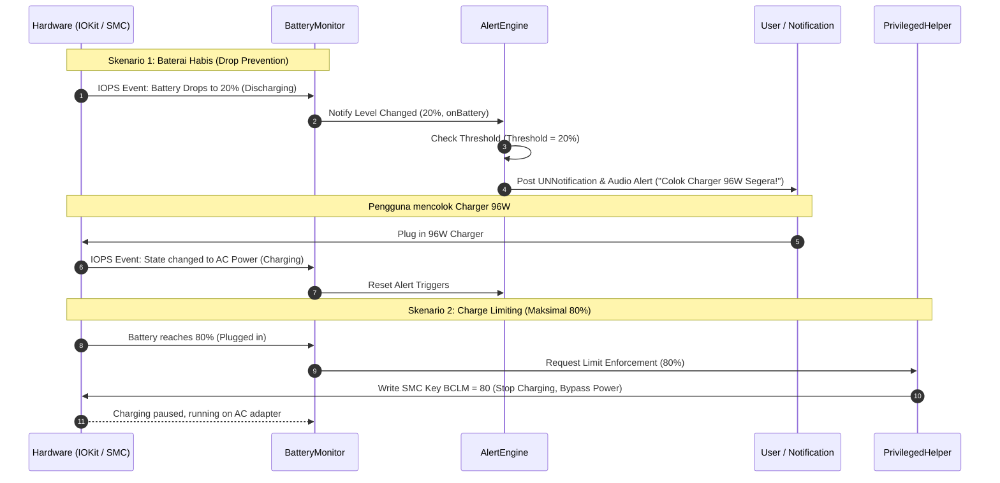

# Technical Architecture Blueprint — BatteryX

## 1. System Overview
**BatteryX** adalah aplikasi utilitas macOS natif dan *lightweight* (< 25MB RAM, < 0.1% CPU) yang dibangun dengan **Swift 6**, **AppKit + SwiftUI**, dan **IOKit**. 

BatteryX dirancang khusus untuk menyelesaikan masalah:
1. **Pencegahan Kondisi Drop Kritis (Under-charge Protection)**: Memberikan peringatan bertingkat (banner notifikasi + audio chime agresif) saat baterai mencapai ambang batas aman kustom (default: 20%) saat beroperasi dengan baterai (*discharging*), mencegah kondisi baterai jatuh ke 1% di mana daya charger 96W kalah bersaing dengan beban komputasi berat.
2. **Perlindungan Kesehatan Baterai (Charge Limiting / Over-charge Protection)**: Membatasi pengisian baterai pada batas maksimal kustom (default: 80%) melalui manipulasi kunci AppleSMC (`BCLM` pada Intel Mac atau kontrol charging pada Apple Silicon) menggunakan *privileged helper tool* yang aman.
3. **Menu Bar Status UI**: Menampilkan informasi sisa waktu penggunaan, tingkat kesehatan baterai, dan kontrol cepat dalam antarmuka menu bar macOS yang modern.

---

## 2. High-Level Architecture Diagram

```mermaid
graph TD
    subgraph SystemLayer ["macOS & Hardware Layer"]
        IOKitPS["IOKit IOPowerSources (Power State & % Capacity)"]
        AppleSMCDriver["AppleSMC Kernel Driver (BCLM / CH0B)"]
        UNCenter["UserNotifications Framework"]
        AudioServices["AudioToolbox / NSSound"]
    end

    subgraph BatteryXApp ["BatteryX Architecture"]
        subgraph CoreApp ["User Space: Menu Bar App (BatteryX)"]
            BatteryMonitor["BatteryMonitor (IOPS RunLoop Source Observer)"]
            AlertEngine["AlertEngine (Low-Battery Warning & Audio Alert)"]
            MenuBarController["MenuBarController (StatusItem + SwiftUI Popover)"]
            SettingsManager["SettingsManager (UserDefaults / AppStorage)"]
            XPCClient["XPCClient / HelperBridge (Privileged Client)"]
        end

        subgraph PrivilegedHelper ["Privileged Helper (batteryx-helper)"]
            SMCService["SMCService (AppleSMC Read/Write Key Engine)"]
            ChargeController["ChargeController (Apply BCLM / Disable Charge)"]
        end
    end

    IOKitPS -->|Hardware State Change Event| BatteryMonitor
    BatteryMonitor -->|Current Level & Power Status| AlertEngine
    BatteryMonitor -->|Live Data| MenuBarController
    SettingsManager -->|Threshold Configs (20% & 80%)| AlertEngine
    SettingsManager -->|Charge Limit Config| XPCClient

    AlertEngine -->|Trigger Banner Alert| UNCenter
    AlertEngine -->|Play Attention Sound| AudioServices

    XPCClient -->|Root Command via Mach Port/Socket| ChargeController
    ChargeController -->|Write BCLM/CH0B Key| AppleSMCDriver
    SMCService -->|Read Raw SMC Keys| AppleSMCDriver
```

---

## 3. Module Breakdown

### 3.1. `BatteryMonitor` (IOKit Power Observer)
* **Tanggung Jawab**:
  * Menggunakan `IOPSNotificationCreateRunLoopSource` untuk memantau perubahan status baterai tanpa melakukan polling interval tinggi yang memboroskan baterai.
  * Mengekstrak metadata baterai dari `IOPSCopyPowerSourcesInfo()`:
    * `currentPercentage` (Int)
    * `isCharging` (Bool)
    * `isPluggedIn` (Bool)
    * `timeRemainingMinutes` (Int?)
    * `batteryHealth` / Max Capacity / Cycle Count.
  * Memancarkan event reaktif ke `AlertEngine` dan `MenuBarController`.

### 3.2. `AlertEngine` (Under-charge Warning Engine)
* **Tanggung Jawab**:
  * Memantau kondisi saat sumber daya adalah baterai (`isPluggedIn == false`).
  * **Tahap Peringatan Bertingkat**:
    * **Warning Level (Kustom: misal 20%)**: Mengirimkan notifikasi macOS standar dan memainkan suara konfirmasi bahwa daya perlu diisi.
    * **Urgent Level (10%)**: Jika masih tidak dicolok, memancarkan notifikasi berulang setiap 60 detik disertai suara sistem "Sosumi" / peringatan keras.
    * **Kritis (5%)**: Pilihan aktivasi otomatis Low Power Mode (`pmset -a lowpowermode 1`).
  * Reset state peringatan secara otomatis begitu kabel charger ditancapkan (`isPluggedIn == true`).

### 3.3. `SMCService` & `ChargeController` (Privileged SMC Engine)
* **Tanggung Jawab**:
  * Mengakses I/O kit matching service `AppleSMC`.
  * Membaca dan menulis kunci register pengisian daya:
    * **Intel Mac**: Kunci `BCLM` (Battery Charge Limit Max, nilai hex uint8, e.g. `0x50` untuk 80%).
    * **Apple Silicon**: Kunci kontrol daya pengisian (`CH0B` / `CH0C`).
  * **Keamanan (Fail-Safe)**:
    * Jika batas tercapai (misal 80%), penulisan kunci menginstruksikan adaptor hanya menyuplai sistem tanpa mengisi baterai (*bypass*).
    * Saat aplikasi/daemon ditutup atau terjadi crash, reset batas pengisian kembali ke default normal (100%) agar Mac tidak mengalami gangguan saat pengguna bepergian.

### 3.4. `XPCClient` / Helper Tool Bridge
* **Tanggung Jawab**:
  * Menjembatani aplikasi menu bar (yang berjalan di *user space*) dengan operasi SMC yang membutuhkan hak akses `root`.
  * Menggunakan Unix Domain Socket atau `SMAppService` / Mach Service untuk validasi perintah kontrol pengisian daya.

### 3.5. `MenuBarController` & SwiftUI Popover UI
* **Tanggung Jawab**:
  * Ikon dinamis di Menu Bar yang menampilkan sisa waktu / persentase baterai serta indikator charging limit aktif.
  * Popover interaktif:
    * Slider batas charging (40% – 90%).
    * Slider batas peringatan baterai lemah (10% – 35%).
    * Toggle "Low Power Mode".
    * Statistik baterai (Suhu, Siklus Baterai, Estimasi Waktu).

---

## 4. Data Flow & Sequence Diagram



---

## 5. Project Directory Structure

```text
batteryX/
├── .agents/
│   ├── rules/
│   │   ├── antigravity-rtk-rules.md
│   │   └── batteryx-standards.md
│   └── skills/
│       └── macos-battery-management/
│           └── SKILL.md
├── Docs/
│   ├── ARCHITECTURE_BLUEPRINT.md
│   ├── PRD.md
│   └── PLAN.md
├── Package.swift
├── Resources/
│   ├── Assets.xcassets
│   └── Info.plist
├── Scripts/
│   ├── install_helper.sh
│   └── build_app.sh
└── Sources/
    ├── BatteryX/                # Executable Menu Bar Application
    │   ├── AppDelegate.swift
    │   ├── BatteryXApp.swift
    │   └── Views/
    │       ├── MenuBarView.swift
    │       ├── PopoverDetailsView.swift
    │       └── SettingsView.swift
    ├── BatteryXCore/            # Reusable Core Business Logic
    │   ├── BatteryMonitor.swift
    │   ├── AlertEngine.swift
    │   ├── SMCDriver.swift
    │   ├── Models/
    │   │   └── BatteryInfo.swift
    │   └── Services/
    │       └── NotificationService.swift
    └── BatteryXHelper/          # Privileged Root Helper for SMC Writing
        ├── main.swift
        └── SMCWriter.swift
```

---

## 6. Target Metrics & Performance Guarantees
* **CPU Idle**: < 0.1% CPU (event-based listening, tanpa `while (true)` atau `Timer.every(1.second)`).
* **Memory Footprint**: < 25 MB RSS RAM.
* **Response Latency**: < 100ms dari perubahan event IOKit ke notifikasi audio pengguna.
* **Fail-Safe Guarantee**: Menjamin *reset-to-default* (unlimited charge) jika helper atau sistem mengalami reboot tidak terduga.
