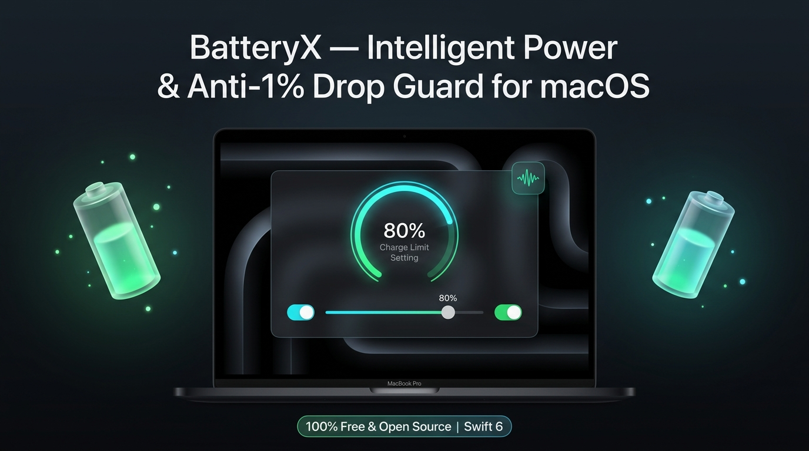
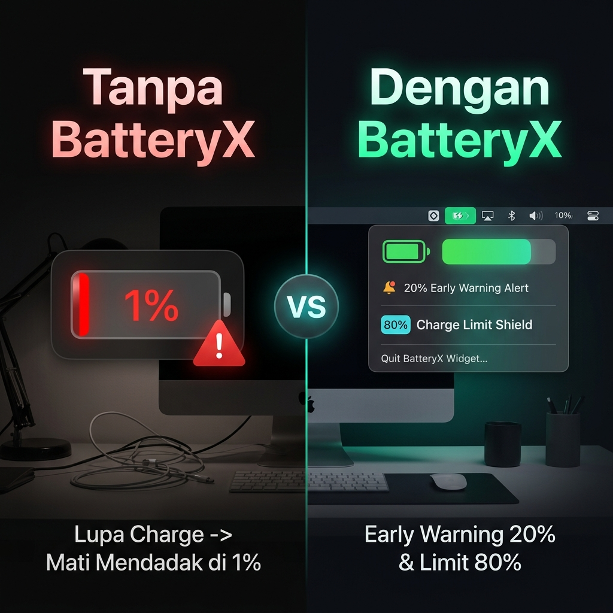
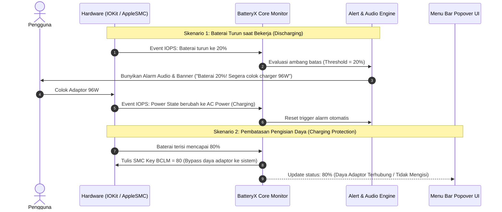

<div align="center">



# ⚡️ BatteryX
### Intelligent Power Guardian & Anti-1% Drop Shield for macOS

[](https://apple.com/macos)
[](https://swift.org)
[](./LICENSE)
[]()
[]()

**BatteryX** adalah utilitas macOS native gratis & open-source yang menggabungkan sistem **peringatan dini baterai kritis (Anti-1% Drop)** dan **pembatas pengisian daya hardware (Charge Limiter)** langsung di Menu Bar Anda.

[💡 The Problem](#-the-problem) • [✨ Features](#-features) • [🚀 Quick Start](#-quick-start) • [📖 How It Works](#-how-it-works) • [🛠️ Architecture](#%EF%B8%8F-architecture--tech-stack) • [📄 License](#-license)

---

</div>

## 💡 The Problem

Sebagai pengguna MacBook yang sering menjalankan beban kerja berat (Docker, IDE, komputasi AI, rendering):
* **Lupa colok charger saat bekerja**: Baterai sering tidak sengaja drop hingga **1%**.
* **Kalah daya saat darurat**: Saat baterai sudah menyentuh 1% dan beban kerja tinggi, adaptor charger (bahkan adaptor berdaya tinggi seperti **96W**) kesulitan menaikkan persentase baterai karena *Battery Management System* (BMS) membatasi arus masuk demi keamanan termal, sementara CPU/GPU menyerap hampir seluruh daya.
* **Baterai cepat aus di 100%**: Jika dicolok terus seharian tanpa batas, baterai berada di tegangan tinggi konstan yang mempercepat degradasi sel baterai dan risiko baterai kembung.

**BatteryX menyelesaikan kedua masalah ini secara elegan dan terpadu!**

---

## ✨ Features

<div align="center">
  
</div>

- 🚨 **Tiered Early Warning System (Anti-1% Drop)**:
  - **Warning Alert (Default: 20%)**: Notifikasi banner macOS + suara audio khas (*Sosumi*) berbunyi saat baterai menyentuh batas aman saat *discharging*, memberi Anda waktu cukup untuk menancapkan charger 96W sebelum terlambat.
  - **Urgent Alert (Default: 10%)**: Alarm berulang setiap 60 detik (*Basso chime*) jika Anda masih belum menancapkan charger.
  - **Auto Reset**: Status peringatan langsung ter-reset otomatis begitu kabel daya tersambung.
- 🛡️ **Hardware Charge Limiter (AppleSMC Control)**:
  - Batasi pengisian maksimal (misalnya berhenti di **80%**) untuk menjaga kesehatan baterai jangka panjang.
  - Daya adaptor dialihkan langsung menyuplai sistem (*pass-through bypass*), membiarkan baterai beristirahat.
  - Tombol **"Charge ke 100% Sekali"** (*Top-Up*) instan saat hendak bepergian.
- 🔄 **Auto Reload & Auto-Start (Launch at Login)**:
  - Otomatis aktif saat macOS dinyalakan atau restart (`SMAppService` native macOS 13+ & LaunchAgent fallback).
  - Langsung memulihkan (*re-apply*) konfigurasi batas daya SMC dan ambang batas alarm secara otomatis begitu sistem selesai booting.
- ⏱️ **Indikator Sisa Waktu Pemakaian (Hours & Minutes)**:
  - Menampilkan perkiraan sisa jam dan menit di Menu Bar persis seperti BatteryBoi, bukan hanya angka persentase.
- ⚡ **Ultra Lightweight & 100% Native**:
  - Dibangun dengan **Swift 6, AppKit, dan SwiftUI**.
  - Menggunakan *event-driven* IOKit (`IOPSNotificationCreateRunLoopSource`) — **RAM < 25MB**, **CPU < 0.1% idle** (tanpa polling interval boros baterai).
- 🔒 **100% Private, Offline & Gratis**:
  - Tidak ada langganan berbayar, bebas analitik, bebas pelacakan data, dan 100% open-source.

---

## 🚀 Quick Start

### 1. Download & Jalankan Aplikasi
Aplikasi rilis siap pakai berada di folder `dist/`:

```bash
# Buka BatteryX langsung
open dist/BatteryX.app

# Atau salin ke folder Applications
cp -R dist/BatteryX.app /Applications/
```

### 2. Pasang Privileged Helper (Untuk Kontrol AppleSMC)
Untuk memungkinkan BatteryX menulis batas pengisian daya ke controller baterai perangkat keras tanpa meminta password root setiap saat:
```bash
./Scripts/install_helper.sh
```

---

## 📖 How It Works



---

## 🛠️ Architecture & Tech Stack

BatteryX dirancang dengan modularitas tinggi:

* **Bahasa**: Swift 6.0
* **Framework UI**: AppKit (`NSStatusItem`) + SwiftUI (`PopoverDetailsView`)
* **Hardware Power Monitoring**: IOKit (`IOPowerSources` event-driven RunLoop source)
* **Hardware Charge Control**: Kernel Driver `AppleSMC` (`BCLM` pada Intel, kontrol daya pada Apple Silicon)
* **Audio & Notifikasi**: `AudioToolbox` + `UserNotifications` + `NSSound`

Dokumentasi spesifikasi teknis lengkap:
* 📄 [Product Requirements Document (PRD)](./Docs/PRD.md)
* 🏗️ [Technical Architecture Blueprint](./Docs/ARCHITECTURE_BLUEPRINT.md)
* 🗺️ [Implementation Plan (Roadmap)](./Docs/PLAN.md)

---

## 🔨 Building from Source

Pastikan Anda memiliki macOS 13+ dan Swift 6:

```bash
# Clone repository
git clone https://github.com/sarno/batteryX.git
cd batteryX

# Kompilasi paket
swift build -c release

# Bungkus menjadi standalone bundle BatteryX.app
./Scripts/build_app.sh
```

---

## 🤝 Contributing

Kontribusi, issue report, dan ide perbaikan sangat diterima!
1. Fork repositori ini
2. Buat branch fitur baru (`git checkout -b feature/FiturKeren`)
3. Commit perubahan Anda (`git commit -m 'Menambahkan fitur keren'`)
4. Push ke branch Anda (`git push origin feature/FiturKeren`)
5. Ajukan Pull Request

---

## 📄 License

Didistribusikan di bawah lisensi **MIT License**. Lihat file [`LICENSE`](./LICENSE) untuk detail selengkapnya.

<div align="center">
  <sub>Built with ❤️ for MacBook power users and developers.</sub>
</div>
